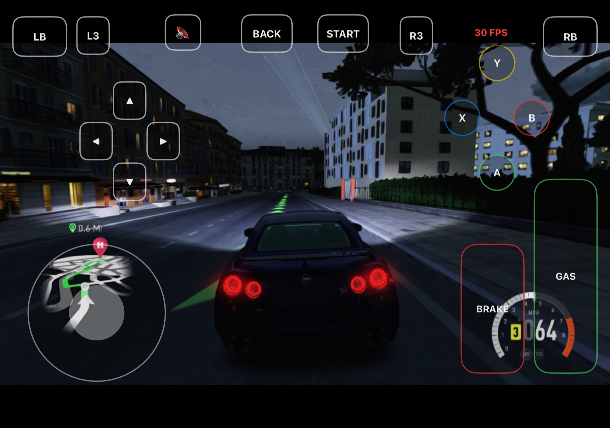
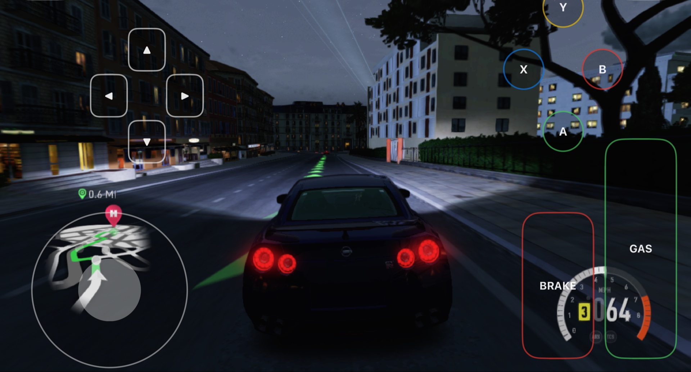

<div align="center">



# FH2 Recompiled for iOS

**Forza Horizon 2 (Xbox 360), statically recompiled and running natively on iPhone. No jailbreak, no emulator for the game code.**

[](#requirements)
[](#how-it-works)
[](#installing-on-your-iphone)
[](LICENSE)
[](https://github.com/Gabrick75/fh2-recompiled)

</div>

> [!IMPORTANT]
> This is a non-commercial fan project for interoperability and preservation research. It is **not** affiliated
> with, endorsed by or sponsored by Microsoft, Xbox Game Studios, Playground Games, Turn 10 Studios or any other
> rights holder. **This repository contains no game files and no game code.** It does nothing without files
> extracted from your own legally obtained copy of the game. See [Legal](#legal).

This is the iOS port of **[FH2 Recompiled](https://github.com/Gabrick75/fh2-recompiled)** by
[Gabrick75](https://github.com/Gabrick75), the static recompilation of Forza Horizon 2 for Android and Linux. All of
the recompilation work comes from that project. This fork adds what it takes to build it as an iPhone app and run
it on Apple's GPUs.

## Table of contents

- [Features](#features)
- [Screenshots](#screenshots)
- [How it works](#how-it-works)
- [Project status](#project-status)
- [Requirements](#requirements)
- [Building from source](#building-from-source)
- [Installing on your iPhone](#installing-on-your-iphone)
- [What the iOS port changes](#what-the-ios-port-changes)
- [Credits](#credits)
- [Legal](#legal)
- [License](#license)

## Features

- **Native iPhone app.** The game's PowerPC code is translated to C++ ahead of time and compiled to ARM64. It is
  not interpreted and there is no JIT, so it runs on a stock, non-jailbroken iPhone.
- **Metal graphics.** The Xbox 360's Xenos GPU is emulated on Vulkan, which runs on Metal through a statically
  linked MoltenVK.
- **Close to the original 30 fps.** On a 2026 iPhone, races hold around 30 fps, the frame rate the Xbox 360 version
  ran at. It drops when the phone gets hot.
- **Touch controls built for racing.** A floating steering stick, gas and brake pedals, ABXY, a D-pad, bumpers,
  BACK/START and stick clicks, swipe-to-look camera and haptics. Touch input is merged with any connected
  controller.
- **In-game overlay.** A frame rate counter and a mute button that remembers its setting.
- **Your files, your phone.** The game files, settings and logs live in the app's Documents folder, visible in the
  Files app and in Finder.
- **Background-safe.** The GPU pauses when you leave the app, because iOS does not allow GPU work in the background.

## Screenshots

<div align="center">

<br><sub>Night drive through Nice, captured on an iPhone.</sub>
</div>

## How it works

| Part | How it runs on iOS |
|---|---|
| Game code (CPU) | Recompiled ahead of time by the [ReXGlue SDK](https://github.com/rexglue/rexglue-sdk): the PowerPC instructions of `default.xex` become C++, built into the app. There is no interpreter or JIT. |
| Xbox 360 kernel and system libraries | Reimplemented by the ReXGlue SDK (derived from [Xenia](https://xenia.jp)). The game's extra modules (XMediaFacade, SpeechFacade) are linked statically and registered at startup, since iOS apps cannot load their own dynamic libraries. |
| GPU (Xenos) | Emulated. The GPU command stream is interpreted, EDRAM is reproduced with render targets and shaders are translated to SPIR-V and then to Metal by MoltenVK. |
| Audio, input, video | SDL3 (UIKit backend), FFmpeg, and a UIKit touch overlay that feeds a virtual Xbox 360 pad. |

The code generated from the game is produced on your own Mac from your own copy of the game. It is excluded from
this repository by `.gitignore`.

## Project status

**Playable, work in progress.** The game boots, plays its intro videos and menus, and you can drive and race.

Known issues:

- Only tested on one device so far (a 2026 iPhone, iPhone19,4, on iOS 27.2). Older iPhones and iPads are untested.
- The frame rate drops below 30 once the phone heats up during long sessions.
- A rare crash in MoltenVK's presentation path is mitigated but not fully proven fixed.
- Sideloading with a free Apple ID means the app has to be re-signed every 7 days.
- The known issues of [FH2 Recompiled](https://github.com/Gabrick75/fh2-recompiled#project-status) apply too, for
  example imperfect collision in places.

## Requirements

**To play**

- An iPhone or iPad on iOS 16 or later (developed and tested on iOS 27.2). A recent device is recommended.
- About 8 GB of free storage for the game files.
- Your own copy of **Forza Horizon 2 for Xbox 360**, USA edition (Title ID `4D530AA4`), dumped from your own disc.

**To build**

- A Mac with Apple Silicon and Xcode (with the iOS SDK).
- CMake 3.25 or later, Ninja, Python 3.8 or later and Git (for example `brew install cmake ninja python git`).
- An Apple ID signed in to Xcode. A free account works. A paid developer account avoids the 7-day re-signing.
- About 20 GB of free disk space (the generated code is large).

## Building from source

1. **Clone this repository and fetch the third-party sources.** The few dependency files this port changed for
   iOS are already in `sdk/thirdparty`, and the script keeps them.

   ```sh
   git clone https://github.com/oChobani/fh2-recompiled-ios.git
   cd fh2-recompiled-ios
   python3 tools/fetch_thirdparty.py
   ```

2. **Extract your own disc image** into `assets/game_root` (ignored by Git):

   ```sh
   python3 tools/fase1_extraer.py /path/to/your/ForzaHorizon2.iso -o assets/game_root
   ```

3. **Build the code generator for your Mac and generate the game's C++** into `app/generated` (ignored by Git):

   ```sh
   cmake --preset mac-arm64 -S sdk
   cmake --build sdk/out/build/mac-arm64 --config Release --target rexglue
   REXGLUE="$(find sdk/out/build/mac-arm64 -name rexglue -type f -perm -u+x | head -1)" tools/codegen.sh app
   ```

4. **Build the SDK for iOS:**

   ```sh
   cmake --preset ios-arm64 -S sdk
   cmake --build sdk/out/build/ios-arm64 --config Release
   ```

5. **Build the app.** Pick your own bundle identifier, and use your team ID from Xcode → Settings → Accounts:

   ```sh
   cmake --preset ios-arm64 -S app -DFH2_IOS_BUNDLE_IDENTIFIER=com.yourname.fh2
   cd app/out/build/ios-arm64
   xcodebuild -project fh2.xcodeproj -target fh2 -configuration Release -sdk iphoneos \
              -allowProvisioningUpdates DEVELOPMENT_TEAM=<YOUR_TEAM_ID> CODE_SIGN_STYLE=Automatic
   ```

   The app is at `app/out/build/ios-arm64/Release-iphoneos/fh2.app`.

> [!NOTE]
> Optional: put a 1024×1024 PNG in `app/ios/Assets.xcassets/AppIcon.appiconset/` to give the app an icon. Icon
> images are ignored by Git, so use artwork you have the right to use.

## Installing on your iPhone

1. On the iPhone, turn on **Settings → Privacy & Security → Developer Mode** and connect it to the Mac once with a
   cable to trust it.
2. **Install the app:**

   ```sh
   xcrun devicectl list devices    # find your iPhone's identifier
   xcrun devicectl device install app --device <DEVICE_ID> app/out/build/ios-arm64/Release-iphoneos/fh2.app
   ```

3. **Copy your game files** into the app's Documents folder as `game_root`:

   ```sh
   xcrun devicectl device copy to --device <DEVICE_ID> --domain-type appDataContainer \
         --domain-identifier com.yourname.fh2 --source assets/game_root --destination Documents/game_root
   ```

   You can also drag the `game_root` folder onto the app in Finder → your iPhone → Files.

4. **Play.** If iOS says the developer is untrusted, approve it in **Settings → General → VPN & Device Management**.

The settings file is `Documents/fh2/fh2.toml` and the logs are in `Documents/fh2/logs/`, both reachable from the
Files app.

## What the iOS port changes

For developers, the main changes on top of FH2 Recompiled:

- **Build:** an iOS toolchain (`sdk/toolchains/ios.cmake`) and `ios-arm64` / `ios-sim-arm64` CMake presets with the
  Xcode generator. Everything is linked statically, including MoltenVK and the Vulkan loader.
- **Modules without `dlopen`:** a static module registry (`sdk/src/system/static_module_registry.cpp`), with
  per-module symbol renaming in `rexglue_helpers.cmake` so each recompiled module keeps its own entry point and
  helpers.
- **Fibers:** the AAPCS64 assembly context switch (`sdk/src/core/fiber_switch.cpp`), made Mach-O safe, because
  `ucontext` is unavailable on iOS.
- **Memory:** a 4 GB guest address space backed by a temporary file mapping, and handling of 16 KB pages.
- **Graphics:** async pipeline creation without frame stalls, memory uploads hoisted out of render passes, iOS
  defaults tuned for speed, and the GPU paused while the app is in the background.
- **MoltenVK:** a fix for a `CAMetalDrawable` use-after-free in the present path (`MVKImage.mm`, `MVKQueue.mm`), plus
  iOS build changes. The modified files are listed in [THIRD_PARTY_NOTICES.md](THIRD_PARTY_NOTICES.md).
- **App:** a UIKit touch overlay (`app/ios/fh2_touch_controls.mm`) feeding a virtual pad (`app/src/fh2_touch_pad.cpp`),
  an `Info.plist` with file sharing, and a crash logger that writes a report on fatal signals.

For the PC and Android builds and everything else, see the upstream README: [README.upstream.md](README.upstream.md).

## Credits

- **[FH2 Recompiled](https://github.com/Gabrick75/fh2-recompiled)** by [Gabrick75](https://github.com/Gabrick75):
  the recompilation of Forza Horizon 2 this port is built on. All the game-specific work, the Android port and the
  renderer improvements are his.
- **[ReXGlue SDK](https://github.com/rexglue/rexglue-sdk)** by Tom Clay: the recompiler and runtime everything here
  is built on.
- **[Xenia](https://xenia.jp)** by Ben Vanik and the Xenia contributors: the Xbox 360 research the SDK's kernel and
  GPU emulation derive from.
- **[Theft4](https://github.com/KoreanSeats1/Theft4)** by KoreanSeats1: the GTA IV iPhone port on the same SDK, used
  as a reference for this one.
- **[MoltenVK](https://github.com/KhronosGroup/MoltenVK)** by the Khronos Group and **[SDL](https://libsdl.org)**.
- Everyone credited by FH2 Recompiled ([README.upstream.md](README.upstream.md#credits)) and the authors of the
  libraries in [THIRD_PARTY_NOTICES.md](THIRD_PARTY_NOTICES.md).

iOS port by [oChobani](https://github.com/oChobani).

## Legal

- **No game content in the repository.** This repository contains only source code under the licenses listed in
  [THIRD_PARTY_NOTICES.md](THIRD_PARTY_NOTICES.md). It does not contain, and will never contain, the game's
  executable, data files, assets, audio, video, artwork, logos or the code generated from the game.
- **Own copy required.** You must own a legitimate copy of the game and use your own dump of it. This project does
  not provide, and does not explain how to obtain, copies of the game.
- **No Microsoft code.** This project does not include code from the Xbox development kit or any other proprietary
  Microsoft software.
- **Trademarks.** Forza, Forza Horizon, Xbox and Xbox 360 are trademarks of the Microsoft group of companies. All
  other trademarks belong to their respective owners. They are used here only to identify the game and platform
  this software is compatible with. No endorsement is implied.
- **Not for commercial use or piracy.** Do not sell this project or builds of it, and do not use it to distribute or
  play unauthorized copies of the game.
- **Takedown requests.** If you are a rights holder and believe something here infringes your rights, please open
  an issue and it will be reviewed and removed promptly.
- **No warranty.** This software is provided "as is", without warranty of any kind, as stated in sections 15 and 16
  of the GPL-3.0. Use it at your own risk.

## License

Like FH2 Recompiled, this port is free software under the [GNU General Public License v3.0](LICENSE). The ReXGlue
SDK in `sdk/`, and changes to it, are under the [BSD-3-Clause license](sdk/LICENSE). Third-party components keep
their own licenses, listed in [THIRD_PARTY_NOTICES.md](THIRD_PARTY_NOTICES.md).
